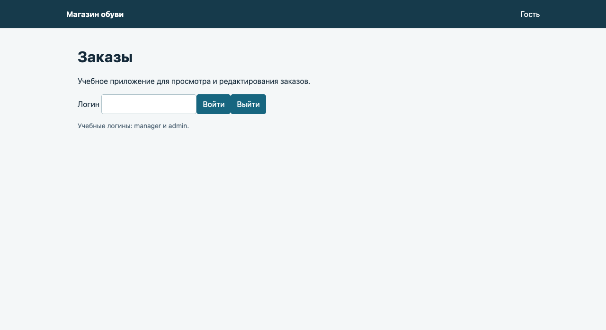
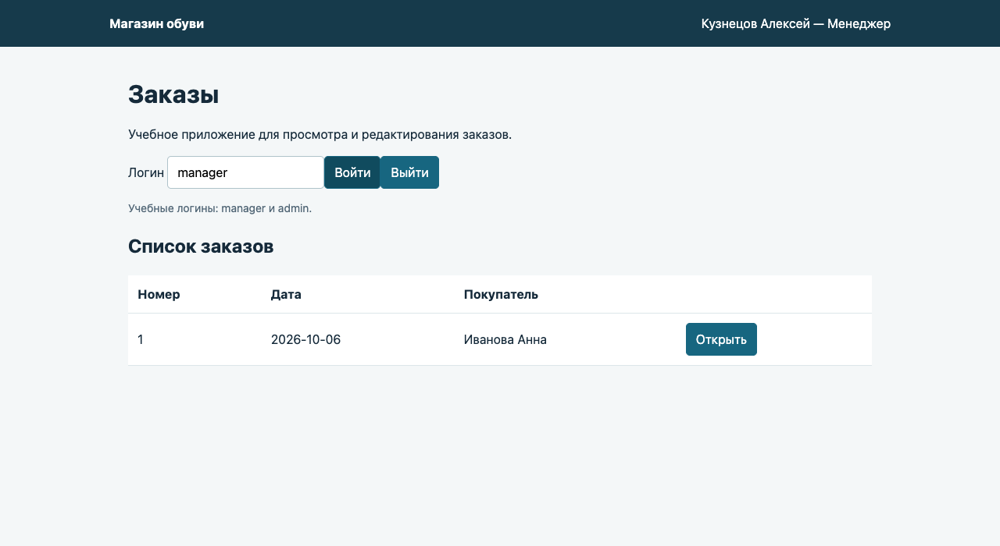
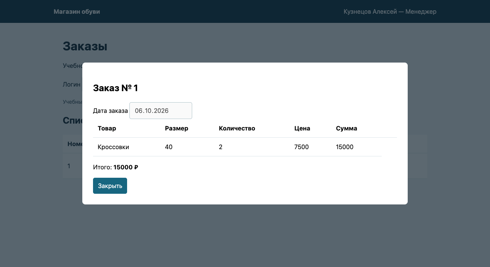
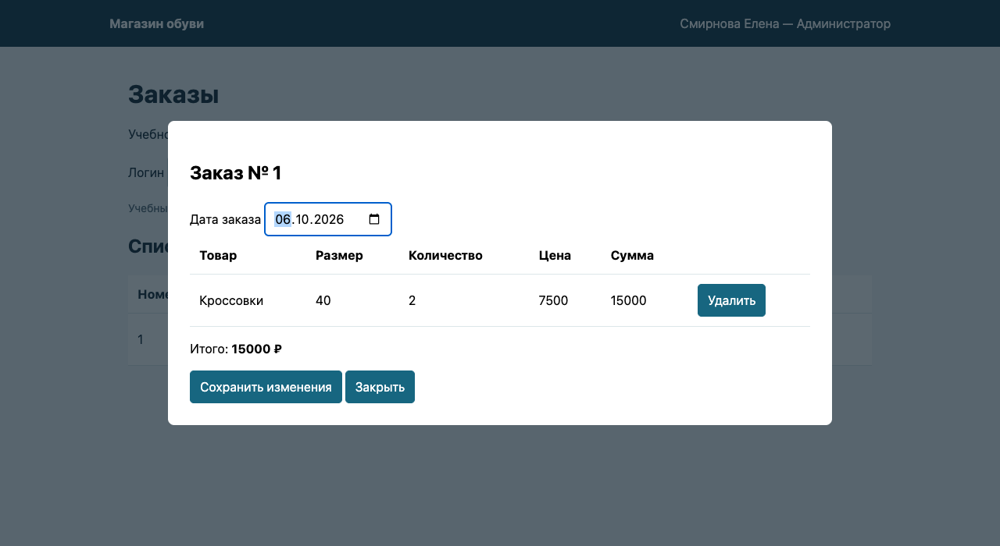

# Практические работы 2.1, 2.2, 2.5, 3.1, 3.2 и 3.4

Выполнил: Бокун Алексей Янович. Группа: 4ИСП9-45.

## Цель

Создать учебный HTTP-сервер и интерфейс, подключить базу SQLite, реализовать просмотр и изменение заказов, изучить документацию используемых модулей.

## Выполненная работа

1. ПР 2.1: сервер на BaseHTTPRequestHandler отдаёт HTML, CSS и JavaScript и обрабатывает JSON-запросы.
2. ПР 2.2: GET /api/login находит пользователя по логину и возвращает id, ФИО и роль; неизвестный логин даёт ответ 404. Проверены пять учебных пользователей.
3. ПР 2.5: созданы index.html, app.js и style.css; объект состояния хранит пользователя, товары, корзину и фильтры, функция api использует fetch.
4. ПР 3.1: отображается список заказов; в окне заказа показаны товар, размер, количество, цена, сумма и итог.
5. ПР 3.2: в режиме администратора можно изменить дату и удалить позицию. После сохранения удалённое количество возвращается на склад. Проверка: количество увеличилось с 8 до 10; после неё данные восстановлены.
6. ПР 3.4: подготовлен конспект по документации Python и MDN; zip_example.py демонстрирует чтение и создание архива.

## Проверка

Проверено на macOS в браузере Chrome с демонстрационной базой SQLite. Скриншоты отображают реальные экраны учебного приложения.









Учебный вход выполняется только по логину; сервер не проверяет роль при изменении заказа. Эта ошибка зафиксирована в баг-репорте по тестированию. Приложение предназначено для локального использования на демонстрационных данных.

## Листинги

### server.py

```python
"""Учебное приложение магазина обуви. Запуск: python3 server.py."""
import json
import mimetypes
import sqlite3
from datetime import date
from http.server import BaseHTTPRequestHandler, ThreadingHTTPServer
from pathlib import Path
from urllib.parse import parse_qs, urlparse

ROOT = Path(__file__).resolve().parent
DB = ROOT.parent / "База_данных" / "shop.db"
STATIC = ROOT / "static"


def connect():
    db = sqlite3.connect(str(DB))
    db.row_factory = sqlite3.Row
    db.execute("PRAGMA foreign_keys=ON")
    return db


class Handler(BaseHTTPRequestHandler):
    def json_response(self, status, value):
        data = json.dumps(value, ensure_ascii=False).encode("utf-8")
        self.send_response(status)
        self.send_header("Content-Type", "application/json; charset=utf-8")
        self.send_header("Content-Length", str(len(data)))
        self.end_headers()
        self.wfile.write(data)

    def do_GET(self):
        parsed = urlparse(self.path)
        params = parse_qs(parsed.query)
        try:
            with connect() as db:
                if parsed.path == "/api/login":
                    user = db.execute("SELECT id, full_name, role FROM users WHERE login=?", (params.get("login", [""])[0],)).fetchone()
                    return self.json_response(200, dict(user)) if user else self.json_response(404, {"error": "Пользователь не найден"})
                if parsed.path == "/api/orders":
                    rows = db.execute("SELECT o.id, o.order_date, u.full_name FROM orders o JOIN users u ON u.id=o.user_id ORDER BY o.id DESC").fetchall()
                    return self.json_response(200, [dict(row) for row in rows])
                if parsed.path == "/api/order":
                    order_id = int(params.get("id", ["0"])[0])
                    rows = db.execute("SELECT oi.id, p.name, s.size, oi.quantity, oi.unit_price, oi.quantity*oi.unit_price AS total FROM order_items oi JOIN products p ON p.id=oi.product_id JOIN sizes s ON s.id=oi.size_id WHERE oi.order_id=?", (order_id,)).fetchall()
                    return self.json_response(200, [dict(row) for row in rows])
            file = (STATIC / ("index.html" if parsed.path == "/" else parsed.path.lstrip("/"))).resolve()
            if STATIC.resolve() not in file.parents or not file.is_file():
                return self.json_response(404, {"error": "Файл не найден"})
            body = file.read_bytes()
            self.send_response(200)
            self.send_header("Content-Type", mimetypes.guess_type(str(file))[0] or "application/octet-stream")
            self.send_header("Content-Length", str(len(body)))
            self.end_headers()
            self.wfile.write(body)
        except (ValueError, sqlite3.Error, OSError) as error:
            self.json_response(400, {"error": str(error)})

    def do_POST(self):
        if self.path != "/api/order/update":
            return self.json_response(404, {"error": "Маршрут не найден"})
        try:
            length = int(self.headers.get("Content-Length", "0"))
            if not 0 < length <= 10000:
                raise ValueError("Неверный размер запроса")
            data = json.loads(self.rfile.read(length))
            order_id = int(data["id"])
            order_date = date.fromisoformat(data["date"]).isoformat()
            removed = [int(item) for item in data.get("removed", [])]
            if len(set(removed)) != len(removed):
                raise ValueError("Повтор позиции")
            with connect() as db:
                if not db.execute("SELECT 1 FROM orders WHERE id=?", (order_id,)).fetchone():
                    raise ValueError("Заказ не найден")
                for item_id in removed:
                    item = db.execute("SELECT product_id, size_id, quantity FROM order_items WHERE id=? AND order_id=?", (item_id, order_id)).fetchone()
                    if item is None:
                        raise ValueError("Позиция не найдена")
                    db.execute("INSERT INTO stock(product_id,size_id,quantity) VALUES (?,?,?) ON CONFLICT(product_id,size_id) DO UPDATE SET quantity=quantity+excluded.quantity", tuple(item))
                    db.execute("DELETE FROM order_items WHERE id=?", (item_id,))
                db.execute("UPDATE orders SET order_date=? WHERE id=?", (order_date, order_id))
            self.json_response(200, {"ok": True})
        except (ValueError, TypeError, KeyError, json.JSONDecodeError, sqlite3.Error) as error:
            self.json_response(400, {"error": str(error)})


if __name__ == "__main__":
    print("http://127.0.0.1:8000", flush=True)
    ThreadingHTTPServer(("127.0.0.1", 8000), Handler).serve_forever()

```

### static/index.html

```html
<!doctype html>
<html lang="ru">
<head>
  <meta charset="utf-8">
  <meta name="viewport" content="width=device-width, initial-scale=1">
  <title>Магазин обуви — заказы</title>
  <link rel="stylesheet" href="/style.css">
  <script src="/app.js" defer></script>
</head>
<body>
  <header><strong>Магазин обуви</strong><span id="current-user">Гость</span></header>
  <main>
    <h1>Заказы</h1>
    <p>Учебное приложение для просмотра и редактирования заказов.</p>
    <form id="login-form"><label>Логин <input name="login" required></label><button>Войти</button><button type="button" id="logout">Выйти</button></form>
    <p class="hint">Учебные логины: manager и admin.</p>
    <p id="message" role="status"></p>
    <section id="orders-section" hidden>
      <h2>Список заказов</h2>
      <table><thead><tr><th>Номер</th><th>Дата</th><th>Покупатель</th><th></th></tr></thead><tbody id="orders"></tbody></table>
    </section>
    <dialog id="order-dialog">
      <form id="order-form">
        <h2 id="order-title"></h2>
        <label>Дата заказа <input type="date" id="order-date" required></label>
        <table><thead><tr><th>Товар</th><th>Размер</th><th>Количество</th><th>Цена</th><th>Сумма</th><th></th></tr></thead><tbody id="items"></tbody></table>
        <p>Итого: <strong id="total"></strong></p>
        <button type="submit" id="save">Сохранить изменения</button>
        <button type="button" id="close">Закрыть</button>
      </form>
    </dialog>
  </main>
</body>
</html>

```

### static/style.css

```css
* { box-sizing: border-box; }
body { margin: 0; font: 16px/1.5 system-ui, sans-serif; color: #152a3a; background: #f4f7f8; }
header { background: #163a4b; color: white; padding: 18px max(24px, calc((100% - 1000px)/2)); display: flex; justify-content: space-between; }
main { max-width: 1000px; margin: 36px auto; padding: 0 24px; }
h1 { font-size: 32px; margin-bottom: 0; }
.hint { color: #506575; font-size: 14px; }
input, button { font: inherit; padding: 8px 12px; border: 1px solid #afc3ca; border-radius: 5px; }
button { background: #176680; color: #fff; cursor: pointer; border-color: #176680; }
button:hover { background: #104b5e; }
table { width: 100%; border-collapse: collapse; background: white; }
td, th { padding: 12px; text-align: left; border-bottom: 1px solid #dce6e9; }
dialog { width: min(850px, 95vw); border: 0; border-radius: 8px; padding: 28px; }
dialog::backdrop { background: #0b1c28aa; }
@media (max-width: 600px) { table { display: block; overflow-x: auto; } main { padding: 0 16px; } }

```

### static/app.js

```javascript
const state = { user: null, products: [], cart: [], filters: {}, order: null, items: [], removed: [] };
const $ = (selector) => document.querySelector(selector);
async function api(url, options) {
  const response = await fetch(url, options);
  const result = await response.json();
  if (!response.ok) throw new Error(result.error || 'Ошибка запроса');
  return result;
}
function message(text) { $('#message').textContent = text; }
function cell(row, value) { const td = row.insertCell(); td.textContent = value; return td; }
async function loadOrders() {
  const orders = await api('/api/orders');
  const body = $('#orders'); body.replaceChildren();
  for (const order of orders) {
    const row = body.insertRow();
    cell(row, order.id); cell(row, order.order_date); cell(row, order.full_name);
    const button = document.createElement('button'); button.textContent = 'Открыть';
    button.addEventListener('click', () => openOrder(order).catch(error => message(error.message)));
    cell(row, '').append(button);
  }
}
async function openOrder(order) {
  state.order = order; state.removed = []; state.items = await api('/api/order?id=' + order.id);
  $('#order-title').textContent = 'Заказ № ' + order.id;
  $('#order-date').value = order.order_date;
  const admin = state.user.role === 'Администратор';
  $('#order-date').disabled = !admin; $('#save').hidden = !admin;
  renderItems(); $('#order-dialog').showModal();
}
function renderItems() {
  const body = $('#items'); body.replaceChildren(); let total = 0;
  for (const item of state.items.filter(item => !state.removed.includes(item.id))) {
    const row = body.insertRow();
    for (const value of [item.name, item.size, item.quantity, item.unit_price, item.total]) cell(row, value);
    total += item.total;
    if (state.user.role === 'Администратор') {
      const button = document.createElement('button'); button.type = 'button'; button.textContent = 'Удалить';
      button.addEventListener('click', () => { state.removed.push(item.id); renderItems(); });
      cell(row, '').append(button);
    }
  }
  $('#total').textContent = total + ' ₽';
}
$('#login-form').addEventListener('submit', async event => {
  event.preventDefault();
  try {
    state.user = await api('/api/login?login=' + encodeURIComponent(event.target.login.value));
    $('#current-user').textContent = state.user.full_name + ' — ' + state.user.role;
    $('#orders-section').hidden = !['Менеджер', 'Администратор'].includes(state.user.role);
    if (!$('#orders-section').hidden) await loadOrders();
    message('');
  } catch (error) { message(error.message); }
});
$('#logout').addEventListener('click', () => { state.user = null; $('#orders-section').hidden = true; $('#current-user').textContent = 'Гость'; });
$('#close').addEventListener('click', () => $('#order-dialog').close());
$('#order-form').addEventListener('submit', async event => {
  event.preventDefault();
  try {
    await api('/api/order/update', { method: 'POST', headers: { 'Content-Type': 'application/json' }, body: JSON.stringify({ id: state.order.id, date: $('#order-date').value, removed: state.removed }) });
    $('#order-dialog').close(); await loadOrders(); message('Изменения сохранены.');
  } catch (error) { message(error.message); }
});

```

### zip_example.py

```python
"""Пример использования zipfile для ПР 3.4."""
from pathlib import Path
from tempfile import TemporaryDirectory
from zipfile import ZipFile

with TemporaryDirectory() as directory:
    path = Path(directory) / "example.zip"
    with ZipFile(path, "w") as archive:
        archive.writestr("readme.txt", "Учебный пример")
    with ZipFile(path) as archive:
        print("Файлы в архиве:", ", ".join(archive.namelist()))
        print("Содержимое:", archive.read("readme.txt").decode("utf-8"))

```

## Конспект по документации

# Практическая работа 3.4 Поиск и анализ информации

Выполнил: Бокун Алексей Янович. Группа: 4ИСП9-45.

**Цель:** найти документацию стандартных модулей Python и функций JavaScript и применить её в учебном проекте.

- [http.server (Python 3.8)](https://docs.python.org/3.8/library/http.server.html): `BaseHTTPRequestHandler` разбирает HTTP-запрос, а методы `do_GET` и `do_POST` реализуют обработку методов. В `server.py` сервер отдаёт страницу и JSON.
- [sqlite3 (Python 3.8)](https://docs.python.org/3.8/library/sqlite3.html): модуль работает со встроенной СУБД SQLite. Параметры запроса передаются отдельно от SQL через `?`; этот способ использован для поиска логина и изменения заказа.
- [zipfile (Python 3.8)](https://docs.python.org/3.8/library/zipfile.html): `ZipFile` читает и создаёт ZIP-архивы. Скрипт `zip_example.py` создаёт архив и проверяет его содержимое.
- [fetch (MDN)](https://developer.mozilla.org/ru/docs/Web/API/Window/fetch): возвращает Promise с ответом на запрос. В `app.js` функция `api` проверяет HTTP-статус и читает JSON.
- [addEventListener (MDN)](https://developer.mozilla.org/ru/docs/Web/API/EventTarget/addEventListener): регистрирует обработчик события; используется для кнопок и отправки форм.
- [JSON.stringify (MDN)](https://developer.mozilla.org/ru/docs/Web/JavaScript/Reference/Global_Objects/JSON/stringify): преобразует объект JavaScript в строку JSON для отправки POST-запроса при сохранении заказа.

**Вывод:** информация из справочников применена для реализации сервера, работы с БД, архива и клиентского интерфейса.

