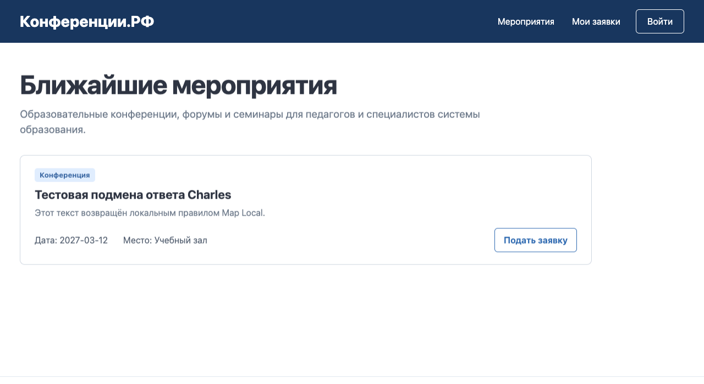

# Работа с Charles

Выполнил: Бокун Алексей Янович. Группа: 4ИСП9-45.

## Ход работы

В Charles 5.2.2 перехвачен запрос `GET http://127.0.0.1:8001/api/events`, отправленный к локальному учебному порталу через прокси `127.0.0.1:8888`. Получен ответ HTTP 200 с JSON-массивом из трёх мероприятий. Системный прокси Charles после запуска выключен; использовался только явно указанный прокси для отдельного запроса.

Для адреса `http://127.0.0.1:8001/api/events` настроено правило Map Local с файлом `events_replacement.json`, содержащим одно тестовое мероприятие. Повторный запрос через Charles вернул HTTP 200 и подменённый JSON; в ответе присутствовал заголовок `X-Charles-Map-Local`.

## Результат

Отдельный браузер, направленный через Charles, отобразил одну карточку «Тестовая подмена ответа Charles». Скриншот результата — `подмена_в_браузере.png`. При прямом запросе к серверу без прокси по-прежнему возвращаются исходные три мероприятия: сама база данных не изменялась.

Проверка выполнена с помощью Map Local. Правило Rewrite отдельно не настраивалось.

